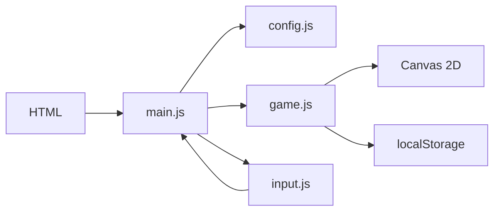
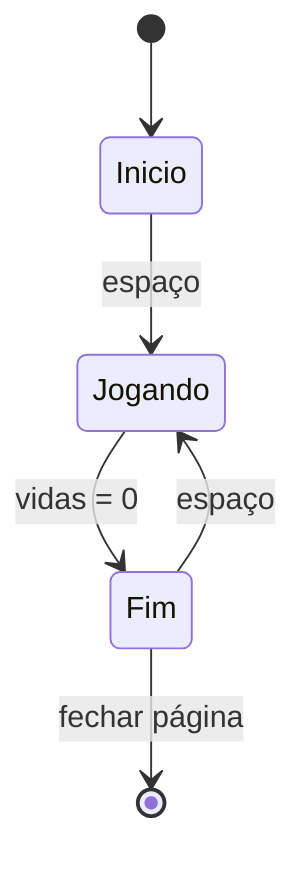

# Design: Chuva de Bugs

## Visão geral
O jogo será uma tela fixa centralizada com canvas em 2D, em que um personagem controlado pelo jogador se desloca horizontalmente e interage com itens que caem do topo. A lógica será dividida em módulos de entrada, estado do jogo e renderização para manter o código simples e verificável. A dificuldade cresce ao longo do tempo, enquanto points e vidas são atualizados por eventos de colisão. O módulo de configuração centraliza constantes e elimina números mágicos no restante do código.

## Decisões técnicas
| Decisão | Escolha | Por quê |
|---|---|---|
| Estrutura | HTML + CSS + JavaScript puro com módulos ES | Segue a stack fixa e funciona em GitHub Pages sem build |
| Renderização | Canvas 2D com emojis e formas básicas | Mantém o visual simples, rápido e compatível com a proposta |
| Estado do jogo | Máquina de estados: início, jogando e fim | Facilita controlar a tela inicial, a partida e a reinicialização |
| Persistência | localStorage no navegador | atende ao requisito de recorde sem criar backend |
| Entrada | listeners de teclado em janela | Simples e suficiente para setas e Espaço |

## Arquitetura


## Estrutura de arquivos
```text
/
├── index.html                 # carrega a página e o canvas central
├── style.css                 # layout da tela e fundo do jogo
├── src/
│   ├── config.js             # constantes do jogo e ajustes gerais
│   ├── input.js              # leitura de teclado e eventos de controle
│   ├── game.js               # estado, loop, colisões, pontuação e telas
│   └── main.js               # inicialização e vínculo entre módulos
└── specs/
    ├── requirements.md       # requisitos do produto
    └── design.md             # decisões de implementação atual
```

## Componentes
### `index.html`: Estrutura da página
- **Responsabilidade:** Definir a área de jogo central e o canvas em que tudo será desenhado.
- **Estado:** Sem estado interno; apenas a estrutura visual da página.
- **Funções principais:** `init()`: não aplicada no HTML; a página apenas prepara o contêiner e o canvas.
- **Atende:** 1.1, 6.1

### `style.css`: Estilo da interface
- **Responsabilidade:** Centralizar a área do jogo, definir o fundo escuro e os elementos visuais da tela.
- **Estado:** Propriedades visuais do layout e da página.
- **Funções principais:** `body`, `.game-shell`, `.hud`: regras de alinhamento, fundo e apresentação.
- **Atende:** 1.1, 6.1

### `src/config.js`: Configuração central
- **Responsabilidade:** Centralizar todos os valores de ajuste do jogo em um único objeto `CONFIG`.
- **Estado:** Constantes globais sem mutação durante a execução.
- **Funções principais:** `export const CONFIG = { ... }`: reúne velocidades, vidas, pontuação inicial e limites da tela.
- **Atende:** 1.1, 3.1, 3.2, 4.3, 5.1, 5.2

### `src/input.js`: Entrada do jogador
- **Responsabilidade:** Escutar teclas de movimento e de ação, e expor um estado de controle para a lógica do jogo.
- **Estado:** `keys.left`, `keys.right`, `keys.space`, `keys.active` para indicar pressão e disponibilidade.
- **Funções principais:** `bindKeyboard()`: registra keydown/keyup; `isPressed(key)`: consulta o estado da tecla.
- **Atende:** 1.2, 2.1, 2.2, 6.2

### `src/game.js`: Lógica principal do jogo
- **Responsabilidade:** Controlar o ciclo do jogo, o estado atual, a criação dos itens, as colisões, a pontuação, as vidas e a tela final.
- **Estado:** `state` (início, jogando, fim), `player`, `items`, `score`, `lives`, `highScore`, `difficulty`.
- **Funções principais:** `resetGame()`: reinicia os valores; `spawnItem()`: cria café ou bug; `update(dt)`: atualiza movimentação e regras do jogo; `resolveCollision(item)`: aplica efeito do item; `draw()`: renderiza a cena; `showGameOver()`: prepara a tela final.
- **Atende:** 1.1, 1.2, 1.3, 2.1, 2.2, 2.3, 3.1, 3.2, 3.3, 3.4, 4.1, 4.2, 4.3, 4.4, 5.1, 5.2, 5.3, 6.1, 6.2, 6.3

### `src/main.js`: Inicialização e loop
- **Responsabilidade:** Montar o jogo, ligar os listeners de teclado e iniciar o loop principal com `requestAnimationFrame`.
- **Estado:** Estado global mínimo para coordenação entre módulos.
- **Funções principais:** `init()`: conecta input, estado e canvas; `gameLoop(timestamp)`: calcula delta time e chama update/draw.
- **Atende:** 1.1, 1.2, 1.3, 6.2

## Configuração central (`CONFIG` em `src/config.js`)
| Constante | Valor inicial | Para que serve | Atende |
|---|---:|---|---|
| `playerSpeed` | 320 | deslocamento horizontal do dev | 2.1, 2.2, 2.3 |
| `playerLives` | 3 | número inicial de vidas | 4.3, 4.4 |
| `initialScore` | 0 | pontuação inicial | 4.3 |
| `spawnInterval` | 1.1 | intervalo base para gerar novos itens | 3.1, 5.2 |
| `itemFallSpeed` | 180 | velocidade inicial de queda | 3.2, 5.1 |
| `difficultyRamp` | 0.08 | aceleração da dificuldade ao longo do tempo | 5.1, 5.2 |
| `groundY` | fundo do canvas | limite inferior para remoção de itens | 3.3 |
| `highScoreKey` | `chuvaDeBugsHighScore` | chave do localStorage para o recorde | 6.3 |

## Fluxo


No loop principal, o fluxo será: calcular o delta time em segundos; se o estado for início, aguardar Espaço; se for jogando, atualizar o jogador, os itens e a dificuldade; quando um item sair do canvas ou colidir com o dev, aplicar a consequência correspondente; atualizar HUD; desenhar a cena; se a vida chegar a zero, trocar para a tela de fim e salvar o recorde; se o estado for fim, aguardar Espaço para reiniciar.

## Propriedades de corretude
- Para qualquer quadro, o dev fica dentro da área horizontal do canvas. (Valida: 2.3)
- Para qualquer item que passe do limite inferior da tela, ele sai da fila sem alterar pontuação nem vidas. (Valida: 3.3)
- Para qualquer colisão com café, a pontuação aumenta exatamente 1. (Valida: 4.1)
- Para qualquer colisão com bug, a vida diminui exatamente 1 e a partida só termina quando o valor chega a zero. (Valida: 4.2, 4.4)
- Para qualquer instante de jogo ativo, a velocidade e a frequência dos itens sobem com o tempo. (Valida: 5.1, 5.2)
- Para qualquer fim de partida, o recorde mais alto disponível é exibido e preservado no navegador. (Valida: 6.1, 6.3)

## Casos limite
- A tela de início recebe espaço repetido: apenas o primeiro pressionamento deve iniciar a partida.
- O jogador pressiona esquerda e direita ao mesmo tempo: o movimento deve ser tratado como sem deslocamento líquido ou como priorização da última tecla.
- Muitos itens são gerados em sequência: a lógica deve manter a lista de itens limitada pela área do canvas e remover os que saíram.
- O recorde ainda não existe: a tela final deve exibir zero como valor inicial e depois sobrescrever com o maior resultado.
- O player pressiona Espaço na tela de fim antes de o final ser renderizado: o estado deve aguardar um quadro estável antes de reiniciar.
